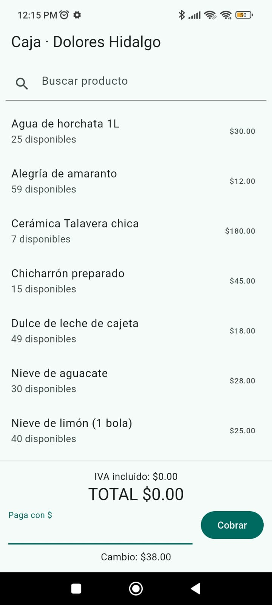
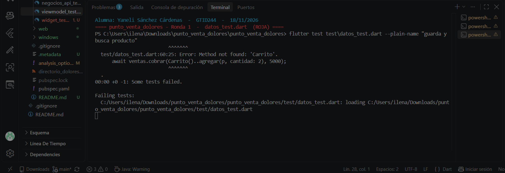
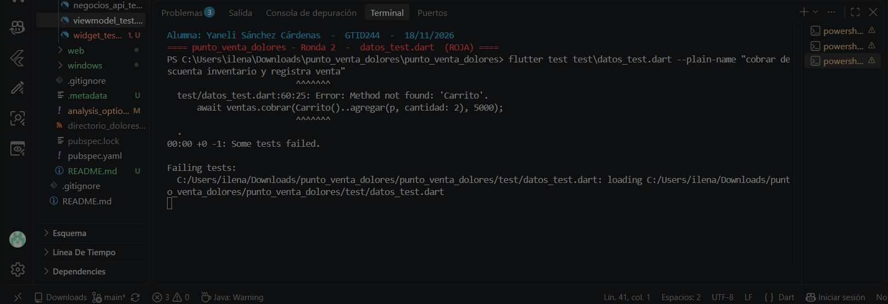
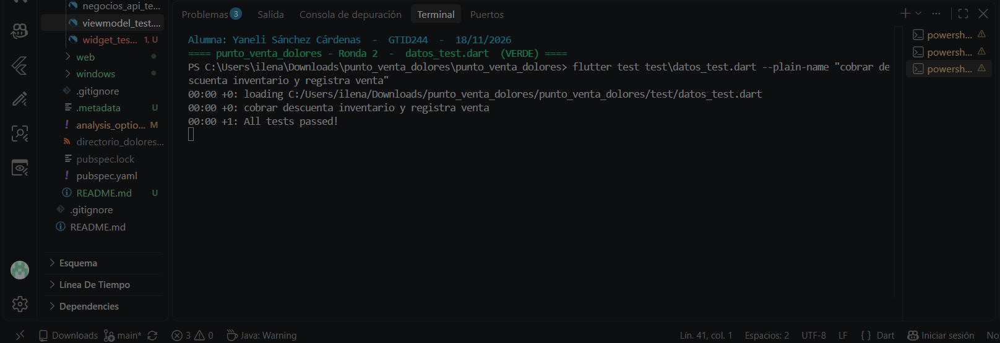
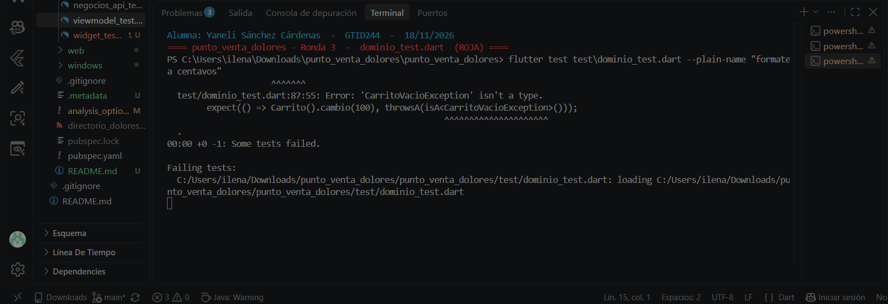
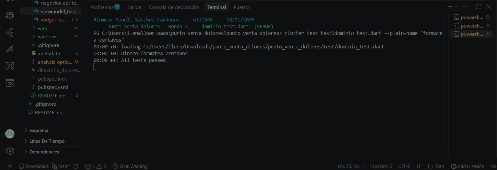
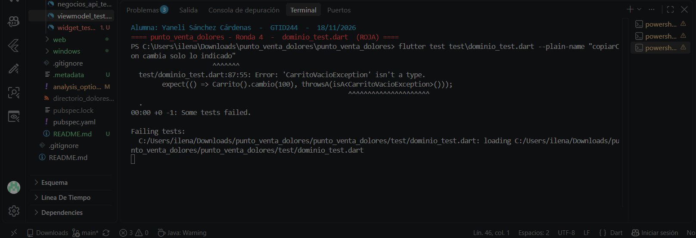
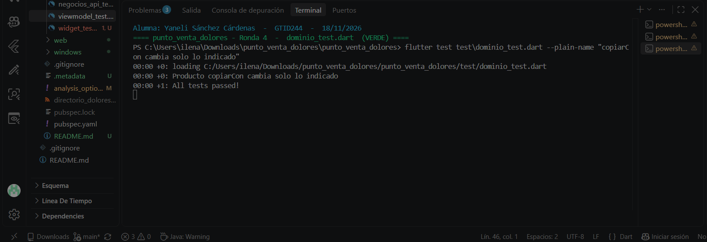
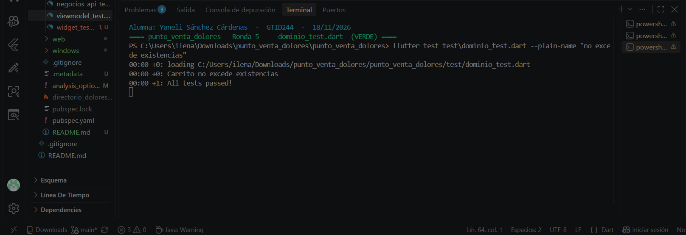
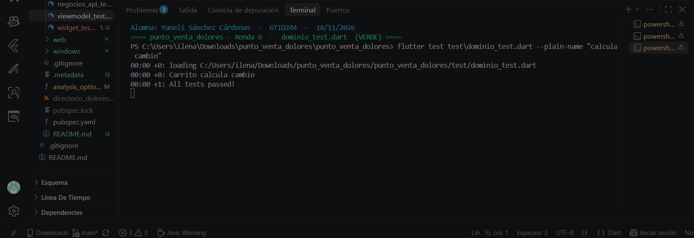

# Punto de Venta Dolores

Punto de venta con SQLite local, dinero en centavos enteros y cobro con transacción, hecho con TDD (Desarrollo Móvil Integral, UTNG).

## Cómo abrirlo y correrlo en Visual Studio Code

1. Descomprime la carpeta `punto_venta_dolores` y ábrela con **File > Open Folder**.
2. Abre la terminal de VS Code (Ctrl + ñ) y ejecuta **una sola vez**, dentro de la carpeta:

   ```
   flutter create .
   flutter pub get
   ```

   `flutter create .` solo agrega las carpetas de plataforma (android, ios, windows, web...). No toca `lib/`, `test/` ni `pubspec.yaml`.
3. Pruebas: `flutter test` (debe terminar con "All tests passed!", 17 pruebas).
4. Ejecutar la app: `flutter run` (elige dispositivo abajo a la derecha en VS Code).

**Importante (SQLite):**
- La app (`flutter run`) usa `sqflite`, que funciona en **Android, iOS y emulador**. No elijas Windows/Web como dispositivo.
- Las pruebas de `test/datos_test.dart` corren en la computadora con `sqflite_common_ffi`. Si en Windows te sale un error de `sqlite3.dll`, descarga sqlite3.dll de sqlite.org (versión 64-bit) y ponla junto a tu ejecutable de Dart o en el PATH.

## Estructura

```
lib/
  dominio/        dinero.dart, producto.dart, carrito.dart, venta.dart, excepciones.dart
  datos/          base_datos.dart, repositorio_productos.dart, repositorio_ventas.dart
  presentacion/   caja_viewmodel.dart, pantalla_caja.dart
  main.dart
test/
  dominio_test.dart, datos_test.dart
```

## La app funcionando en el celular



---

## Evidencias TDD (rojo → verde)

**Alumna:** Yaneli Sánchez Cárdenas · **Grupo:** GTID244

Cada ronda muestra primero la prueba en **rojo** (falla porque el código aún no existe) y después en **verde** (pasa con la implementación).

### Ronda 1

**🔴 Rojo — la prueba falla**



**🟢 Verde — la prueba pasa**


### Ronda 2

**🔴 Rojo — la prueba falla**



**🟢 Verde — la prueba pasa**



### Ronda 3

**🔴 Rojo — la prueba falla**



**🟢 Verde — la prueba pasa**



### Ronda 4

**🔴 Rojo — la prueba falla**



**🟢 Verde — la prueba pasa**



### Ronda 5

**🔴 Rojo — la prueba falla**


**🟢 Verde — la prueba pasa**



### Ronda 6

**🔴 Rojo — la prueba falla**


**🟢 Verde — la prueba pasa**


